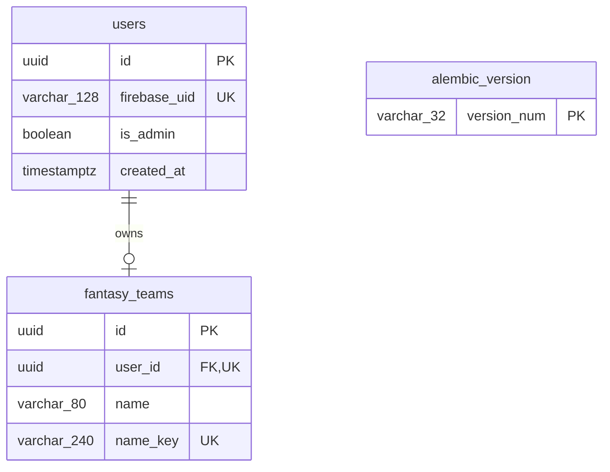

# Schema 0002 — Identity and global team names

Alembic revision: `0002`; parent: `0001`.

Unique constraints: Firebase UID; fantasy-team user ID; normalized global name key.
All identity IDs are internal UUIDs. Team-name normalization uses NFKC, collapsed
whitespace, and case folding. Display names preserve capitalization.
