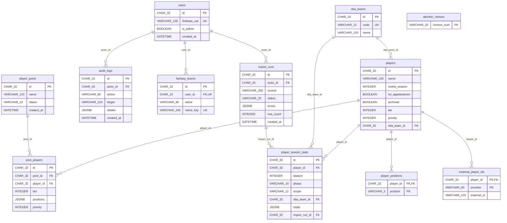

# Schema 0003 — Player catalog and immutable pools

Alembic revision: `0003`; parent: `0002`.

Composite uniqueness: external IDs (provider, external_id); player positions
(player_id, position); season statistics (player_id, season, phase, scope);
pool entries (pool_id, player_id). Player name is indexed.

Checks constrain positions, tier ranges, pool status, statistics phases, and
aggregate-versus-team scope. PostgreSQL triggers reject edits and deletions of
published pools and reject inserts, edits, or deletions of their entries.

Statistics totals use a validated JSONB object. Import source/time/errors live on
import_runs; averages are derived on read. Admin audit records store actor,
action, target, details, and timestamp. Archive players instead of deleting them.
