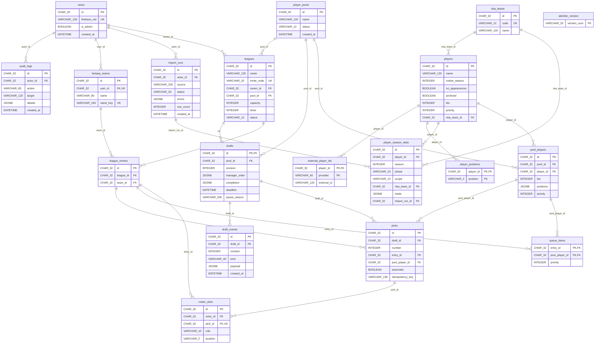

# Schema 0005 — Durable draft events

Alembic revision: `0005`; parent: `0004`.

Adds draft_events, with a unique (draft_id, revision) constraint. Each event
contains its type, JSON payload and creation timestamp. Start, pick, pause,
resume and lineup events commit in the same transaction as the associated
state change. Replay is ordered by revision; no process-local event bus is used.
All constraints, triggers and indexes from revision 0004 remain in place.
